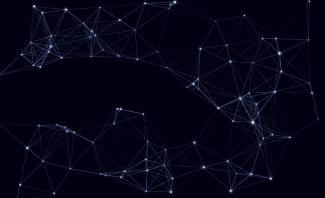
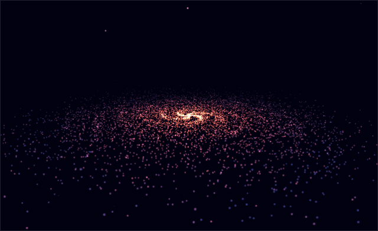
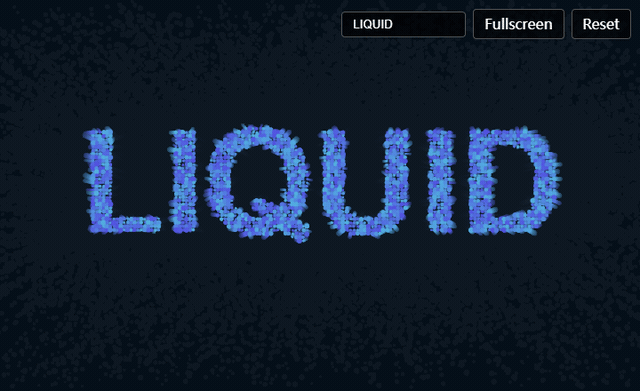
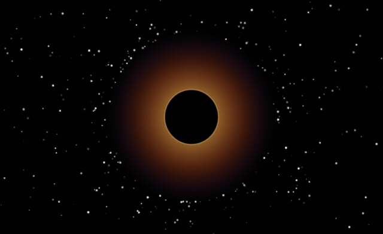
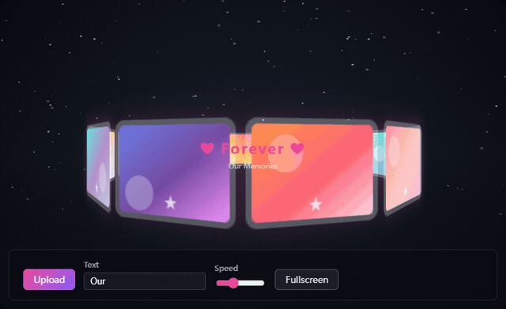

# 51yifei — Interactive visual effects

[中文版本 / Chinese version](README.zh-CN.md)

A curated set of **interactive visual effects** extracted from [51yifei](https://51yifei.com/en/) — each one is a single self-contained file with no build step and no tracking scripts.

## Showcases

| # | Demo | Preview |
|---|------|---------|
| 1 | [Constellation](constellation/) |  |
| 2 | [3D Particle Galaxy](three-particle-galaxy/) |  |
| 3 | [Aurora Borealis](aurora-borealis/) |  |
| 4 | [Liquid Text](text-liquid/) |  |
| 5 | [Black Hole](black-hole/) |  |
| 6 | [Starry 3D Album](starry-3d-album/) |  |

## One-click tools from 51yifei

Every entry links straight to the live site — one click and you are there:

- [3D Particle Galaxy](https://51yifei.com/en/visual-effects/three-particle-galaxy/) — Three.js 8000-particle spiral galaxy with mouse parallax interaction
- [Constellation](https://51yifei.com/en/visual-effects/constellation/) — Star particles with mouse-drawn constellation lines
- [Starry Particles](https://51yifei.com/en/visual-effects/starry-particles/) — Galaxy nebula particles, rotating and twinkling
- [Aurora Borealis](https://51yifei.com/en/visual-effects/aurora-borealis/) — Canvas 2D gradient aurora animation, dynamic flow
- [Black Hole Lensing](https://51yifei.com/en/visual-effects/black-hole/) — A black hole bends light with its immense gravity, stretching background starlight into a glowing Einstein ring.
- [Liquid Text Morph](https://51yifei.com/en/visual-effects/text-liquid/) — Text fuses separates and flows like mercury
- [Nebula Generator](https://51yifei.com/en/visual-effects/nebula-generator/) — Procedural nebula generation, volumetric rendering with color flow, multiple presets
- [3D Dynamic Ocean](https://51yifei.com/en/visual-effects/three-ocean/) — Three.js ShaderMaterial dynamic wave ocean, mouse creates ripples
- [Volumetric Clouds](https://51yifei.com/en/visual-effects/volumetric-clouds/) — Layered fractal Brownian motion noise generates volumetric clouds that billow and drift pixel by pixel.
- [Caustics](https://51yifei.com/en/visual-effects/caustics/) — Simulates sunlight refracting through water, casting shifting web-like light patterns on the seabed.
- [Flow Field](https://51yifei.com/en/visual-effects/flow-field/) — Countless particles drift along a noise-based vector field, tracing silky trails like wind or ocean currents.
- [God Rays](https://51yifei.com/en/visual-effects/god-rays/) — Light streaming through gaps forms radiating volumetric shafts; drag the light source and switch its colour.
- [Prime Polar Spiral](https://51yifei.com/en/visual-effects/prime-polar-spiral/) — Map prime numbers to golden-angle polar coordinates, creating sunflower spiral patterns with animated drawing and color schemes.
- [3D Neon Tunnel](https://51yifei.com/en/visual-effects/three-neon-tunnel/) — Three.js first-person neon geometric tunnel traversal
- [Heart Particle Timer](https://51yifei.com/en/visual-effects/heart-timer/) — Large pulsating heart made of particles with customizable timer and messages.
- [Sky Lantern](https://51yifei.com/en/visual-effects/sky-lantern/) — Click to launch glowing lanterns that float upward and burst into starlight particles at the top. Customize your wish.
- [Light Candles](https://51yifei.com/en/visual-effects/light-candles/) — Light candles one by one, their glow illuminates the darkness. Light them all to reveal a blessing and starlight.
- [Mouse Follow Blob](https://51yifei.com/en/visual-effects/mouse-follow-blob/) — Fluid blob effect that follows and sticks to your cursor
- [Liquid Glass Jelly](https://51yifei.com/en/visual-effects/liquid-glass/) — Sticky liquid jelly effect like iOS icons
- [Firework Text](https://51yifei.com/en/visual-effects/firework-text/) — Fireworks explode then particles converge into text, then disperse

## License

MIT — the code is extracted from the 51yifei project for showcase purposes.
